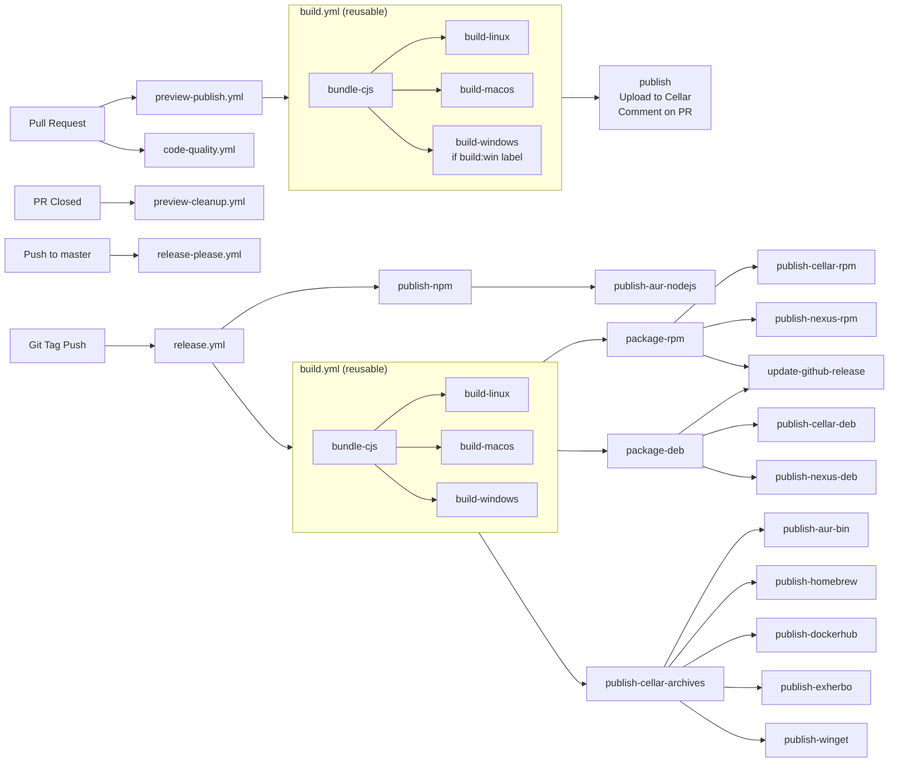

# Build, CI and release

## Overview

1. **Pull request**:
   - `code-quality.yml` runs the checks (see [code-quality.md](code-quality.md)).
   - `preview-publish.yml` builds and publishes preview binaries (see [issues-commits-and-prs.md](issues-commits-and-prs.md)).
2. **PR closed**: `preview-cleanup.yml` deletes the preview.
3. **Push to `master`**: `release-please.yml` opens or updates the release PR.
4. **Release PR merged**: release-please creates the version tag, which triggers `release.yml`: build, then publication to every distribution channel.

| Workflow | Trigger | What it does |
|---|---|---|
| `code-quality.yml` | PR | Commits, rebase, lint, format, types, generated docs, unit tests |
| `preview-publish.yml` | PR (not Markdown-only), `build:win` label | Builds with `build.yml`, uploads to Cellar, comments the download links on the PR |
| `preview-cleanup.yml` | PR closed | Deletes the preview from Cellar, updates the PR comment |
| `release-please.yml` | Push to `master` | Opens or updates the release PR, resolves `since`, regenerates the docs |
| `release.yml` | Tag push | Builds, packages and publishes the release |
| `build.yml` | Called by the above | Bundles the source, then compiles the Linux, macOS and Windows binaries and archives |

`code-quality.yml`, `preview-publish.yml` and `preview-cleanup.yml` skip release-please branches. The secrets and variables used by the workflows can be compared with what is configured on the repository with `node scripts/check-github-actions.js`.



## Versioning

[release-please](https://github.com/googleapis/release-please) keeps a `chore(master): release X.Y.Z` PR open. It computes the next version and aggregates the CHANGELOG from the conventional commit messages merged since the last release (see [issues-commits-and-prs.md](issues-commits-and-prs.md)). Don't hand-edit `CHANGELOG.md` or bump the version in `package.json`.

New commands are declared with `since: null`. On every push to `master`, if a release PR is open, `release-please.yml` checks out its branch, runs `scripts/resolve-since.js` with the upcoming version, fails if a `since: null` remains, runs `npm run docs`, and pushes a ``docs(commands): resolve `since` to version X.Y.Z`` commit to the release PR.

## Build

- **Bundling**: `scripts/bundle-cjs.js` uses Rollup to create a single CommonJS file from the ESM source.
- **Compilation**: `scripts/build-binary.js` uses [`@yao-pkg/pkg`](https://github.com/yao-pkg/pkg) to compile the bundle for Linux, macOS and Windows. The embedded Node.js major version comes from the `volta` field of `package.json`.[^volta]
- **Packaging**: `scripts/create-archive.js` creates `.tar.gz` and `.zip` archives, `scripts/package-nfpm.js` the `.deb` and `.rpm` packages.

The Node.js version used by the workflows also comes from the `volta` field of `package.json` (`actions/setup-node` with `node-version-file: package.json`).[^volta] Keep it in sync with `mise.toml`, used by local dev setups. The npm publication is the exception: it uses the latest Node.js LTS, needed for the OIDC trusted publishing on npmjs.org.

## Distribution channels

Environment variables are listed by name, the values are secrets or variables of the CI.

| Channel | Script | What is published | Environment variables |
|---|---|---|---|
| npm | `npm publish` | The `clever-tools` package, with provenance | |
| GitHub Releases | `update-github-release.js <version>` | Archives, `.deb` and `.rpm` | `GITHUB_TOKEN` |
| Cellar | `publish-cellar.js <version> <artifact>` | Archives, `.deb` and `.rpm`, for direct downloads | `CC_CLEVER_TOOLS_RELEASES_CELLAR_BUCKET`, `CC_CLEVER_TOOLS_RELEASES_CELLAR_KEY_ID`, `CC_CLEVER_TOOLS_RELEASES_CELLAR_SECRET_KEY` |
| Nexus | `publish-nexus.js <version> <packager>` | `.deb` and `.rpm` repositories | `NEXUS_USER`, `NEXUS_PASSWORD`, `NEXUS_RPM_REPOSITORY` or `NEXUS_DEB_REPOSITORY` |
| AUR | `publish-aur.js <version> <flavor>` | `clever-tools` (Node.js flavor, after npm) and `clever-tools-bin` (binary, after Cellar), see [AUR packages](#aur-packages) | `AUR_GIT_URL` |
| Homebrew | `publish-homebrew.js <version>` | The tap formula | `HOMEBREW_GIT_URL` |
| Docker Hub | `publish-dockerhub.js <version>` | Version and `latest` images | `DOCKERHUB_USERNAME`, `DOCKERHUB_TOKEN`, `DOCKER_IMAGE_NAME`, `DOCKERHUB_GIT_URL`, `CC_CLEVER_TOOLS_RELEASES_CELLAR_BUCKET` |
| Exherbo | `publish-exherbo.js <version>` | The exheres package | `EXHERBO_GIT_URL` |
| WinGet | `publish-winget.js <version>` | The manifest, submitted through the `clevercloud-ci/winget-pkgs` fork | `CI_TOKEN`, `CC_CLEVER_TOOLS_RELEASES_CELLAR_BUCKET`, `WINGET_PACKAGE_ID` |

A failed step of the release can be re-run on its own from the Actions tab (re-run failed jobs): only the failed job and the jobs that depend on it run again, the ones that already succeeded keep their result and are not published twice.

## Scripts

The Node.js scripts in `scripts/` are used by the CI and the release workflow (the `npm` scripts are in [code-quality.md](code-quality.md#npm-scripts)). Each script documents its usage in its header comment, and supports `--help`.

The scripts share code in `scripts/lib/` (`runCommand` for `--help` and error handling, the Cellar client, git, templates, terminal output…) and the package manager templates in `scripts/templates/`. A new script uses them instead of reimplementing the same things, and follows the header comment of the others (usage, arguments, environment variables, required system binaries, examples).

### Development

| Script | What it does |
|---|---|
| `generate-docs.js [--check]` | Behind `npm run docs` and `npm run docs:check`. |
| `check-github-actions.js` | Lists the secrets and variables used by the workflows and compares them with what is configured on the repository. |
| `preview.js build [branch]` | Bundles, compiles and installs a preview binary locally. Slow, needs `tar` (PowerShell `Compress-Archive` on Windows). |
| `preview.js update [filter]` | Downloads or updates the published previews matching the filter, then offers to delete the local ones no longer published. The other `preview.js` subcommands are under Release. |

### Shell completion

Shipped in the npm package, run by users through the `install-clever-completion` and `uninstall-clever-completion` commands.

| Script | What it does |
|---|---|
| `install-autocomplete.sh` | Installs the bash and zsh completion scripts of `clever`. |
| `uninstall-autocomplete.sh` | Removes them. |

### Build

Run by the `build.yml` workflow, slow to run locally.

| Script | What it does | Environment variables |
|---|---|---|
| `bundle-cjs.js <version> <isPreview>` | Bundles the ESM source into a single CommonJS file with Rollup. | |
| `build-binary.js <version>` | Compiles the bundle into a native binary for the current OS with `@yao-pkg/pkg`. The architecture is hardcoded per OS (Linux x64, macOS arm64, Windows x64, `scripts/lib/build-binary.js`): on an arm64 Linux or an Intel Mac, the binary targets the wrong architecture. | |
| `create-archive.js <version> <createLatest>` | Packages the binary into a `.tar.gz` or `.zip` archive. | |
| `package-nfpm.js <version> <packager>` | Builds the RPM or DEB package with nfpm, GPG-signed. | `RPM_GPG_PRIVATE_KEY`, `RPM_GPG_PASSPHRASE` |

### Release

Run by the preview and release workflows. Most publish to shared Cellar buckets, package registries or GitHub, and need secrets: leave them to the CI. Running one by hand is only for exceptional cases, by a maintainer. The publication scripts (`publish-*.js`, `update-github-release.js`) are listed with their environment variables in [Distribution channels](#distribution-channels).

| Script | What it does | Environment variables |
|---|---|---|
| `resolve-since.js <version>` | Replaces `since: null` in command definitions by the upcoming version, on the release PR branch. | |
| `preview.js publish\|delete [branch]` | Publishes or deletes a PR preview on Cellar. | `CC_CLEVER_TOOLS_PREVIEWS_CELLAR_BUCKET`, `CC_CLEVER_TOOLS_PREVIEWS_CELLAR_KEY_ID`, `CC_CLEVER_TOOLS_PREVIEWS_CELLAR_SECRET_KEY` |
| `preview.js pr-comment [branch]` | Prints the PR comment with the download links of a preview, for `preview-publish.yml`. Only useful to the CI. | |

## AUR packages

`scripts/publish-aur.js` publishes a package flavor to the Arch User Repository. It is run by the `release.yml` workflow, not by hand.

Both flavors are published from templates in `scripts/templates/aur/<flavor>/`. The `.SRCINFO` is templated alongside the `PKGBUILD`, so both files must be edited together and kept in sync (`makepkg --printsrcinfo` regenerates it for comparison). On an Arch Linux machine, a template change can be validated end to end against a local bare repository (`git init --bare`, then point `AUR_GIT_URL` to it), without ever touching AUR.

## Docker image

`scripts/publish-dockerhub.js` publishes the Docker image. It is run by the `release.yml` workflow, not by hand: it commits and tags the Docker Hub repository, then builds and pushes the image.

The image doesn't build clever-tools from source: `scripts/templates/dockerhub/Dockerfile` downloads a published Linux archive (`downloadUrl`) and installs the binary on a slim Debian. To build it locally, render the template with the archive of your choice, then build and run it:

```bash
node --input-type=module -e "
import { applyTemplates } from './scripts/lib/templates.js';
await applyTemplates('build/docker', 'scripts/templates/dockerhub', {
  downloadUrl: 'https://clever-tools.clever-cloud.com/releases/latest/clever-tools-latest_linux.tar.gz',
  version: 'local',
  description: 'clever-tools',
  license: 'Apache-2.0',
  maintainer: 'local',
});
"
docker build -t clever-tools:local build/docker
docker run --rm clever-tools:local version
```

To test the image with the code of a pull request, use the Linux archive of its preview instead (linked in the preview comment of the PR): `https://clever-tools-preview.clever-cloud.com/previews/<branch>/linux/clever-tools-<branch>_linux.tar.gz`.

[^volta]: Temporary. The `volta` field of `package.json` is still read by the CI and by `scripts/lib/build-binary.js`. Once [#1185](https://github.com/CleverCloud/clever-tools/issues/1185) is done, the Node.js versions are pinned in `mise.toml` only.
