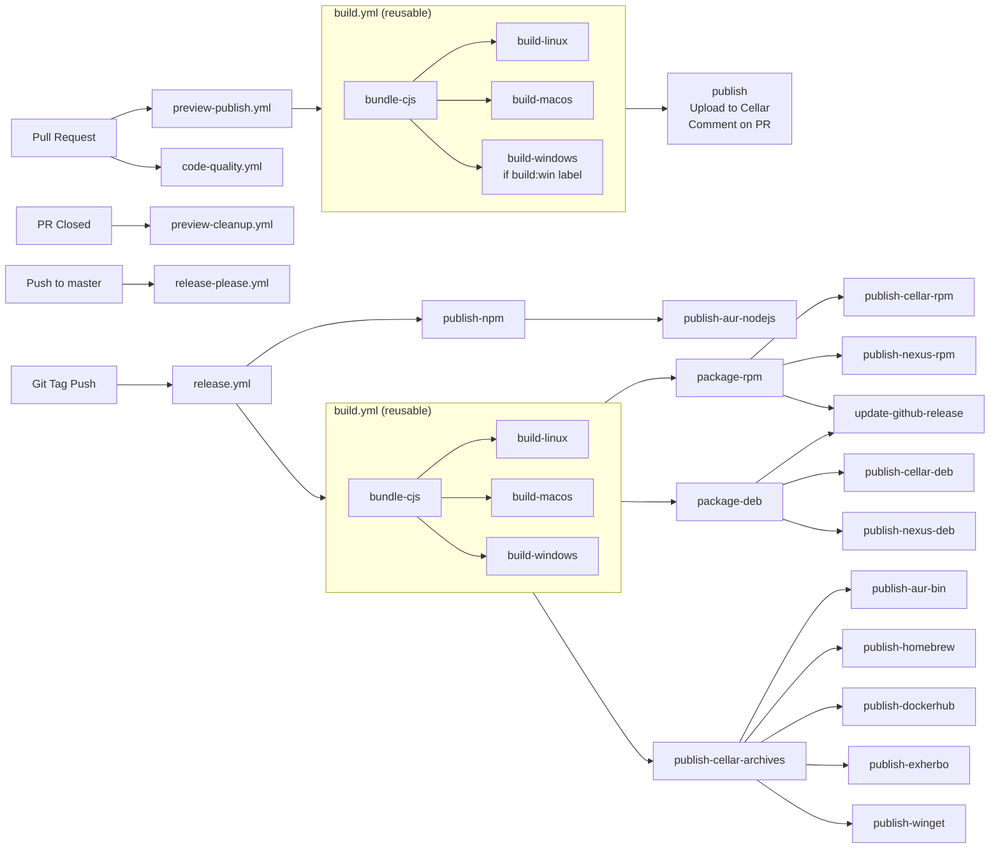

# Build, CI and release

## Overview

1. **Pull request**:
   - `code-quality.yml` runs the checks (see [code-quality.md](code-quality.md)).
   - `preview-publish.yml` builds and publishes preview binaries (see [issues-commits-and-prs.md](issues-commits-and-prs.md)).
2. **PR closed**: `preview-cleanup.yml` deletes the preview.
3. **Push to `master`**: `release-please.yml` opens or updates the release PR.
4. **Release PR merged**: release-please creates the version tag, which triggers `release.yml`: build, then publication to every distribution channel.

| Workflow | Trigger | What it does |
|---|---|---|
| `code-quality.yml` | PR | Commits, rebase, lint, format, types, generated docs, unit tests |
| `preview-publish.yml` | PR (not Markdown-only), `build:win` label | Builds with `build.yml`, uploads to Cellar, comments the download links on the PR |
| `preview-cleanup.yml` | PR closed | Deletes the preview from Cellar, updates the PR comment |
| `release-please.yml` | Push to `master` | Opens or updates the release PR, resolves `since`, regenerates the docs |
| `release.yml` | Tag push | Builds, packages and publishes the release |
| `build.yml` | Called by the above | Bundles the source, then compiles the Linux, macOS and Windows binaries and archives |

`code-quality.yml`, `preview-publish.yml` and `preview-cleanup.yml` skip release-please branches. The secrets and variables used by the workflows can be compared with what is configured on the repository with `node scripts/check-github-actions.js`.

## Versioning

[release-please](https://github.com/googleapis/release-please) keeps a `chore(master): release X.Y.Z` PR open. It computes the next version and aggregates the CHANGELOG from the conventional commit messages merged since the last release (see [issues-commits-and-prs.md](issues-commits-and-prs.md)). Don't hand-edit `CHANGELOG.md` or bump the version in `package.json`.

New commands are declared with `since: null`. On every push to `master`, if a release PR is open, `release-please.yml` checks out its branch, runs `scripts/resolve-since.js` with the upcoming version, fails if a `since: null` remains, runs `npm run docs`, and pushes a `docs(commands): resolve since to version X.Y.Z` commit to the release PR.

## Build

- **Bundling**: `scripts/bundle-cjs.js` uses Rollup to create a single CommonJS file from the ESM source.
- **Compilation**: `scripts/build-binary.js` uses [`@yao-pkg/pkg`](https://github.com/yao-pkg/pkg) to compile the bundle for Linux, macOS and Windows. The embedded Node.js major version comes from the `volta` field of `package.json`.[^volta]
- **Packaging**: `scripts/create-archive.js` creates `.tar.gz` and `.zip` archives, `scripts/package-nfpm.js` the `.deb` and `.rpm` packages.

The Node.js version used by the workflows also comes from the `volta` field of `package.json` (`actions/setup-node` with `node-version-file: package.json`).[^volta] Keep it in sync with `mise.toml`, used by local dev setups. The npm publication is the exception: it uses the latest Node.js LTS, needed for the OIDC trusted publishing on npmjs.org.

## Distribution channels

| Channel | Script | What is published |
|---|---|---|
| npm | `npm publish` | The `clever-tools` package, with provenance |
| GitHub Releases | `update-github-release.js` | Archives, `.deb` and `.rpm` |
| Cellar | `publish-cellar.js` | Archives, `.deb` and `.rpm`, for direct downloads |
| Nexus | `publish-nexus.js` | `.deb` and `.rpm` repositories |
| AUR | `publish-aur.js` | `clever-tools` (Node.js flavor, after npm) and `clever-tools-bin` (binary, after Cellar) |
| Homebrew | `publish-homebrew.js` | The tap formula |
| Docker Hub | `publish-dockerhub.js` | Version and `latest` images |
| Exherbo | `publish-exherbo.js` | The exheres package |
| WinGet | `publish-winget.js` | The manifest, submitted through the `clevercloud-ci/winget-pkgs` fork |

A failed step of the release can be re-run on its own from the Actions tab (re-run failed jobs): only the failed job and the jobs that depend on it run again, the ones that already succeeded keep their result and are not published twice.

The package manager templates live in `scripts/templates/`. Every script documents its usage in its header comment and supports `--help` (see [scripts.md](scripts.md)).

## AUR packages

`scripts/publish-aur.js` publishes a package flavor to the Arch User Repository. It is run by the `release.yml` workflow, not by hand.

Both flavors are published from templates in `scripts/templates/aur/<flavor>/`. The `.SRCINFO` is templated alongside the `PKGBUILD`, so both files must be edited together and kept in sync (`makepkg --printsrcinfo` regenerates it for comparison).

[^volta]: Temporary. The `volta` field of `package.json` is still read by the CI and by `scripts/lib/build-binary.js`. Once [#1185](https://github.com/CleverCloud/clever-tools/issues/1185) is done, the Node.js versions are pinned in `mise.toml` only.
